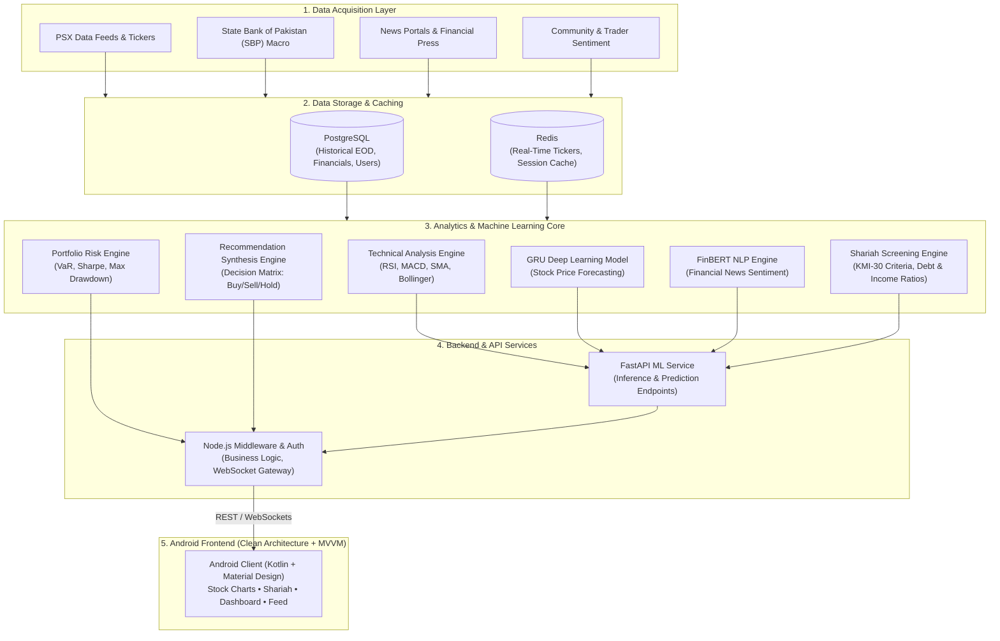
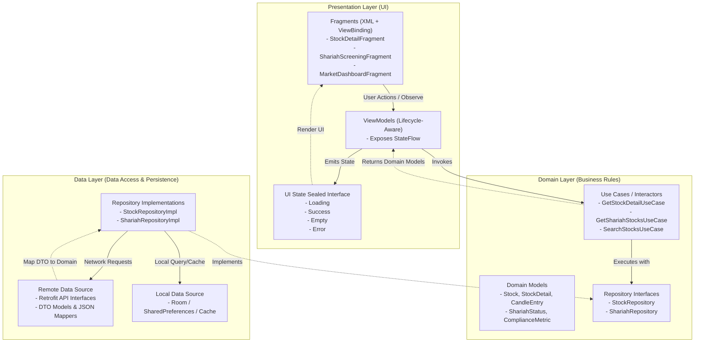

# BASARAT (بصيرة) 📈
### AI-Powered Trade Recommendation & Assistance System for Pakistan Stock Exchange (PSX)

[](#)
[](#)
[](#)
[](#)
[](#)
[-00B894)](#)

---

## 🌟 1. Project North Star & Overview

**BASARAT** is a mobile-first, decision-support financial intelligence platform tailored specifically for the **Pakistan Stock Exchange (PSX)**. It combines deep quantitative market analysis, machine learning forecasts, financial news sentiment, comprehensive Shariah compliance screening, portfolio risk analytics, and community-driven trader insights.

> **Important Boundary Rule**: The Android application functions strictly as the **presentation layer**. The client consumes processed data and ML predictions via secure REST/WebSocket APIs; it does not perform raw web scraping, GRU training, FinBERT inference, or database management on-device.

---

## 🏛️ 2. High-Level System Architecture

The following flowchart illustrates the entire computation and data processing pipeline across the BASARAT ecosystem—from raw financial feeds to the Android client UI:



---

## 📱 3. Android Client Architecture

The mobile client is engineered according to **Clean Architecture** principles and the **MVVM (Model-View-ViewModel)** design pattern. It enforces strict separation of concerns, unidirectional data flow, and immutable state representation.



### Unidirectional Data Flow & State Contract
Every network-backed or data-driven screen strictly adheres to a finite state contract:

```kotlin
sealed interface UiState<out T> {
    data object Loading : UiState<Nothing>
    data class Success<T>(val data: T) : UiState<T>
    data object Empty : UiState<Nothing>
    data class Error(val message: String) : UiState<Nothing>
}
```

---

## 👥 4. Team Ownership & Responsibilities

| Contributor | Focus Areas & Assigned Responsibilities |
| :--- | :--- |
| **Abdul Rehman** | **Stock Analysis & Detailed Charts**, **User Dashboard**, **Sentiment Analysis**, **Community Trading Hub** |
| **Ahmed Khan** | **User Management & Auth**, **Risk Analytics (VaR/Sharpe)**, **ML Price Forecasting (GRU)**, **Recommendation Engine**, **Personal AI Assistant** |
| **Talal Umar** | **Market Dashboard**, **Portfolio Management**, **News & Events Intelligence**, **Shariah Compliance Screening**, **Web Scraping & Ingestion** |

---

## 🎨 5. Design System & Financial UI Standards

BASARAT uses a clean, modern, light-first financial design inspired by world-class investment terminals, while upholding specific PSX market semantics.

### Color Palette

| Token | Hex | Role | Usage |
| :--- | :--- | :--- | :--- |
| `Background` | `#FFFFFF` | Core Background | Main activity & screen canvas |
| `Surface` | `#F7F9F8` | Surface Background | Subtle background cards, chips |
| `Primary Text` | `#111827` | High Emphasis Text | Financial numbers, stock symbols, titles |
| `Secondary Text`| `#667085` | Medium Emphasis | Captions, timestamps, descriptions |
| `BASARAT Green`| `#00B894` | Brand Accent | Active indicators, brand highlights |
| `Positive/Bull`| `#18B981` | Financial Semantic | Price gains, bullish badges, Buy signals |
| `Negative/Bear`| `#EF4444` | Financial Semantic | Price losses, bearish badges, Sell signals |
| `Shariah Teal` | `#14A89B` | Compliance Semantic| Halal status, compliance tags |
| `AI Blue/Purple`| `#4F7CFF` / `#7C6FE8` | Intelligence | AI forecast horizon, sentiment gauges |
| `Gold Accent`  | `#D4A84F` | Premium Accent | Watchlist highlights, key badges |

### Layout & Typography Guidelines
- **Spacing Grid**: Strict 8dp incremental system (`4dp`, `8dp`, `12dp`, `16dp`, `24dp`, `32dp`).
- **Typography Hierarchy**: Financial prices (`30–36sp Bold`), Section headers (`16–18sp Semibold`), Body (`14–16sp Regular`), Captions (`12sp Medium`).
- **Touch Targets**: Minimum `48dp` for all actionable buttons, tabs, and interactive chart chips.
- **Card Corners**: Standardized `12dp` to `16dp` radius with subtle borders/elevations.

---

## 📁 6. Project Directory Structure

```text
com.fyp.basarattradeinvest/
│
├── MainActivity.kt                 # Single Activity Host (NavHostFragment & BottomNav)
│
├── core/                           # Shared foundational utilities & base classes
│   ├── navigation/                 # Navigation graphs & routing helpers
│   ├── network/                    # Retrofit clients, interceptors & error handlers
│   ├── theme/                      # App theme helpers & color definitions
│   └── utils/                      # Formatting extensions (PKR currency, dates, percentages)
│
├── domain/                         # Pure business logic layer (No Android dependencies)
│   ├── model/                      # Domain entities (Stock, CandleEntry, ShariahStock, etc.)
│   └── repository/                 # Repository interface definitions
│
├── data/                           # Concrete data implementations
│   ├── mock/                       # Local deterministic mock data generators
│   ├── remote/                     # Retrofit API services and DTOs
│   └── repository/                 # Repository implementations (e.g. StockRepositoryImpl)
│
└── feature/                        # Feature-first modular presentation packages
    ├── splash/                     # Animated splash & bootstrap flow
    ├── onboarding/                 # User intro & value proposition walkthroughs
    ├── auth/                       # Authentication, registration & reset flows
    ├── dashboard/                  # Home dashboard (KSE-100, gainers, losers, sentiment)
    ├── markets/                    # Market overview, sector breakdown, search
    ├── stock/                      # Comprehensive stock deep-dive module
    │   ├── detail/                 # StockDetailFragment, MPAndroidChart Candlesticks
    │   └── adapter/                # News, quote metrics, and timeframe adapters
    └── shariah/                    # Shariah compliance screening (KMI-30, debt ratios)
```

---

## 🚀 7. Getting Started & Development

### Prerequisites
- **Android Studio**: Ladybug (2024.2.1) or newer
- **JDK**: Java 17 (configured under Gradle JDK)
- **Android SDK**: Compile SDK `35`, Min SDK `24`

### Building the Project
Clone the repository and build via Gradle:
```bash
# Clone the repository
git clone https://github.com/abd476/Basarat1.0.git

# Navigate to project root
cd BasaratTradeInvest

# Build debug APK
./gradlew assembleDebug

# Run unit tests
./gradlew testDebugUnitTest
```

---

## ⚖️ 8. Disclaimer
BASARAT is a quantitative and computational decision-support tool created for educational and informational analysis of the Pakistan Stock Exchange (PSX). It is **not** a certified financial advisory service or a SECP-licensed brokerage. Predictions, Shariah compliance indicators, and technical recommendations are probabilistic models and should not be construed as guaranteed investment advice.
